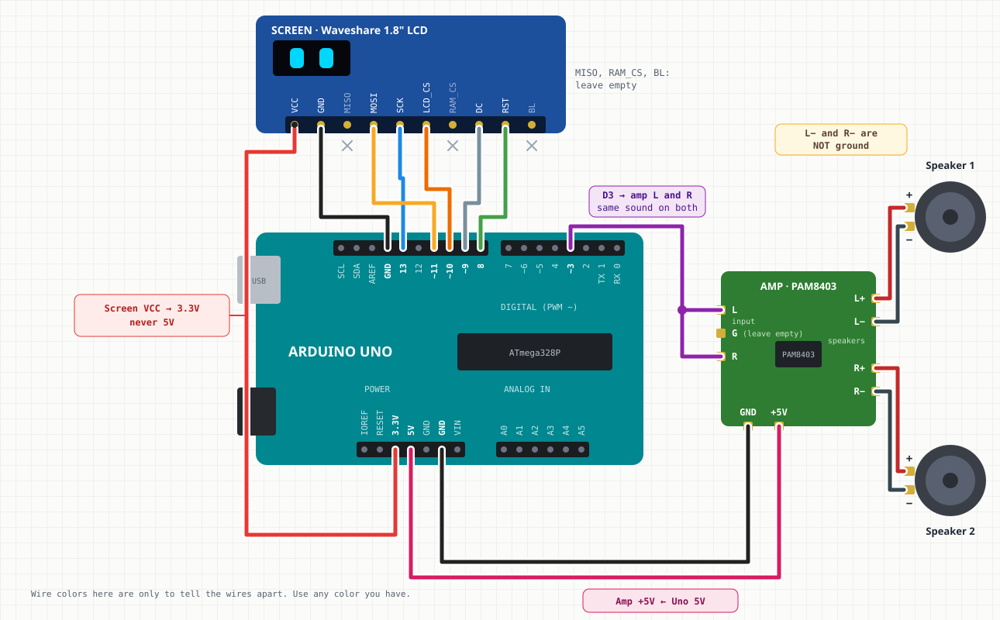
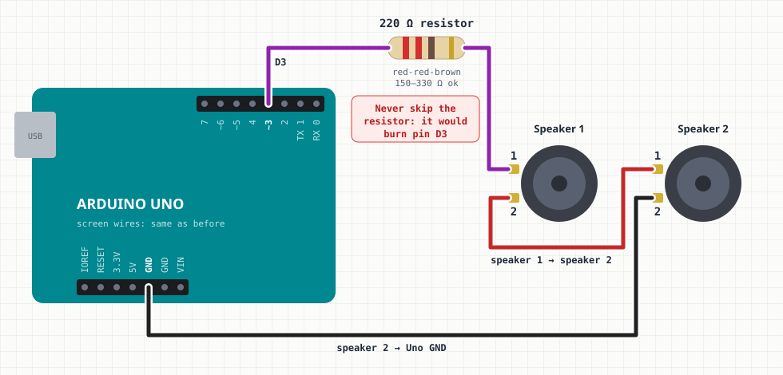
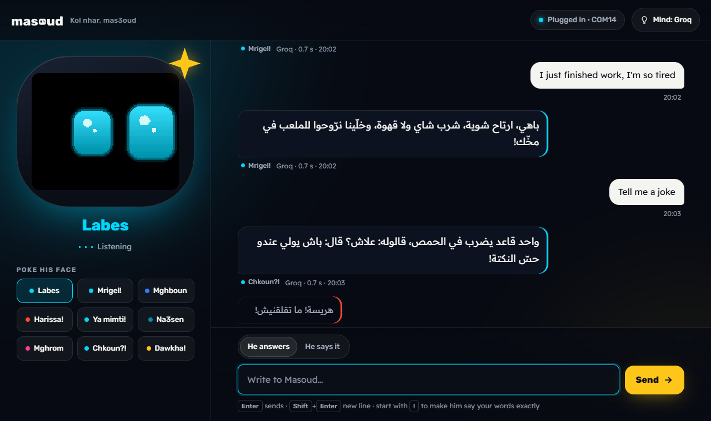

# masoud — the lucky desk buddy


**Masoud** (مسعود, "the lucky one") is a Tunisian desk buddy robot: a face that shows how he
feels, a voice, a shake sensor, and an AI mind you choose on day one, on your own computer,
in the cloud, or none at all. He speaks English, French and Arabic. *Kol nhar, mas3oud*: every day, a lucky one.

| Folder | What's in it |
|---|---|
| [`brand/`](brand/) | Logo files as plain SVG paths, and [`launch-book.html`](brand/launch-book.html), the cinematic brand and launch book (open it in a browser): a live 3D Masoud whose eyes follow your pointer, name, logo rules, colors, type, Derja voice, first-run setup, parts, pricing, 90-day plan. |
| [`firmware/masoud_uno/`](firmware/masoud_uno/) | The working prototype: Masoud's face on an Arduino Uno + Waveshare 1.8" ST7735S screen. |
| [`tools/`](tools/) | `masoud_live.py` keeps him talking and serves the chat page (`masoud_chat.html`), `masoud_mind.py` is his AI mind, `masoud_say.py` makes him say anything. `emo_preview.cpp` renders the face on a PC with the same code, `make_splash.py` builds the boot wordmark, `make_logos.py` builds the logo SVGs. |
| [`docs/`](docs/) | Images used here. |

## The face today

 


He boots on his logo with a hello chirp, then lives on his own: glowing eyes with sparkles,
blinks, glances, blush when he's happy, and every few seconds a mood with its own sound. Drive him from the Serial Monitor (115200), one key at a time:

| Key | Mood | Key | Mood |
|---|---|---|---|
| `n` | *Labes*, calm | `z` | *Na3sen*, sleepy with Zzz |
| `h` | *Mrigel!*, happy | `l` | *Mghrom*, heart eyes |
| `s` | *Mghboun*, sad | `?` | *Chkoun?!*, suspicious |
| `a` | *Harissa!*, angry | `d` | *Dawkha!*, dizzy: what the shake sensor will trigger |
| `u` | *Ya mimti!*, surprised | `b` `w` | blink, wink |

`4 6 8 2 5` look around, `x` turns autonomous mode on and off. Each mood change is printed in Derja.

### Wiring



The full sheet with a tick-off checklist and a guide to amp pin labels is [`docs/wiring.html`](docs/wiring.html) (open it in a browser).

**No amp?** The speakers can go straight on the Uno through one resistor (quieter):



`D3 --[220 Ω]-- speaker 1 -- speaker 2 -- GND`. Never leave the resistor out: a bare speaker would burn pin D3.

### His voice

Masoud uses the same **PAM8403 amp and two small speakers** as the arduino-sound-player
project. The only change is the pin: that project used D9/D10, which drive Masoud's screen,
so the amp input moves to **D3** (Timer2's free PWM output; Timer1 becomes the 8 kHz sample clock).

```
D3  -> PAM8403 left AND right input        optional: D3 --[1k]--+-- amp in, 10 nF to GND
5V  -> PAM8403 VCC
GND -> PAM8403 GND
PAM8403 L/R out -> the two speakers
```

- **Talk only (default):** the chirps are off; his only sound is his voice. Build with
  `-DMASOUD_CHIRPS=1` to bring back the robot chirps below.
- **Chirps, optional:** every mood has its own robot chirp, synthesized on the Uno
  (rising for *Mrigel!*, a sigh for *Mghboun*, a buzz for *Harissa!*, a wobble for *Dawkha!*),
  plus a hello at boot.
- **Speech from the PC:** `tools/masoud_say.py` turns text into Microsoft's multilingual voice
  Remy (`fr-FR-RemyMultilingualNeural`, the same voice in English, French and Arabic, pitched up a
  little), shapes it for 28 mm speakers and streams it over USB with the sound project's credit flow
  control. His eyes pulse while he talks. The Uno buffers 64 ms of speech (512 bytes), enough to ride
  out a hiccup on the PC: with 32 ms, one answer in five had a 25 ms click.

**He always talks:** `tools/masoud_live.py` greets you, says a line on every mood change, and after
~18 s of quiet says something by himself, in the language he last spoke. **His AI mind writes these lines**:
one call returns a fresh batch (a line for each mood and five quiet-room lines: a question about your day,
a fun fact, a tiny joke, the time of day, a kind reminder). The batch knows the weekday, the part of the day and
what you just chatted about (*How did the CNC project turn out?*) and never repeats his last lines. Batches
are voiced ahead of time, so every line still comes out at once. They are topped up whenever a mood runs
out, at most one call per 40 s (a few % of Groq's free tier). When the mind is offline or on Pet, the fixed
lines fill in (*Grr! Don't make me angry!*, *Je t'adore !*, *أحبك كثيرا!*...). The log marks AI lines `(ai)`.
Type a sentence to make him say it, or a mood key (`h s a u z l ? d n`).

- `python tools/masoud_live.py --install`: start with Windows in the background; it waits for him to
  be plugged in and reconnects after unplugging (log in `%LOCALAPPDATA%\masoud\live.log`).
- It holds his USB port, so run `python tools/masoud_live.py --stop` before uploading a sketch;
  `--uninstall` removes the autostart.

```sh
pip install edge-tts pyserial          # and ffmpeg on PATH
python tools/masoud_live.py            # he talks by himself and answers you (chat page or here)
python tools/masoud_live.py --install  # ...always, from every Windows start
python tools/masoud_say.py "Bonjour ! Je suis Massoud" --mood h
python tools/masoud_say.py "مرحبا" --preview hello.wav     # hear it without the robot
```

Listen to [`docs/masoud-voice-sample.wav`](docs/masoud-voice-sample.wav) for what he sounds like
(8 kHz, 8-bit, exactly what the robot plays).

### Chat with him: his AI mind



While `masoud_live.py` runs, open **http://127.0.0.1:8766** (`--install` puts a *Chat with Masoud*
shortcut on the Desktop). Write in English, French or Arabic: his mind answers in the same language
(Arabizi gets Arabic), his face on the robot (and on the page) takes the answer's mood, and he says it
out loud. *Mind → Language* can fix one language instead. *He says it* mode, or a message that starts with `!`, makes him say your words exactly.
The mood buttons poke his face. If the background talker is running, `python tools/masoud_live.py`
in a terminal chats through it too.

The mind is `tools/masoud_mind.py`, the launch book's "choose his mind" on a PC. Pick it on the
page (the *Mind* button) or in `%LOCALAPPDATA%\masoud\mind.json`. In *Auto*, he uses the first one
that works. Any other choice goes first, and the rest back it up, so he never goes quiet; only Pet has no backup (no AI, on purpose):

| Mind | Needs | Speed |
|---|---|---|
| Claude API | your Anthropic key | about 1 s |
| Groq (`openai/gpt-oss-120b`) | a free key from console.groq.com | under 1 s; if Groq retires a model he moves to the next |
| Claude CLI | the `claude` CLI, signed in once with `claude auth login` | a few s |
| Ollama | Ollama running on this PC | depends on the PC |
| Pet | nothing | canned answers |

Keys stay on this PC and never go back to the page. The server only listens on 127.0.0.1 and
refuses requests from other websites. From your message, his text shows in about 1 s and his
voice starts after 3 to 5 s: the voice takes about 2 s to render.

**His languages:** `python tools/masoud_mind.py --eval` sends 12 messages (English, French, Arabic
and Arabizi) and checks the answer's language: 12/12, 1.2 s average on Groq. One voice, Remy, says all
three; whatever he says in Latin letters spells his name "Massoud", because voices read "Masoud" as
"Mazou" in French and "a sued" in English (checked with Whisper). The prompt is kept short because
Groq's free tier allows 8,000 tokens a minute; when the big model's minute is used up the smaller
one answers.

```sh
python tools/masoud_mind.py --eval --mind groq        # right language? (about 2 minutes, paced)
python tools/masoud_mind.py "Salut, ça va ?"          # test his mind alone, no robot
python tools/masoud_mind.py --chat --mind groq        # a console chat with one mind
```

### Build and flash

Wiring (Uno → LCD header): 3.3V→VCC, GND→GND, D13→SCK, D11→MOSI, D10→LCD_CS, D9→DC, D8→RST. Sound: D3 → PAM8403 (above).
The panel is 3.3 V only and RGB order (MADCTL `0x60`). Close the IDE's Serial Monitor before uploading.

```sh
arduino-cli compile --fqbn arduino:avr:uno firmware/masoud_uno
arduino-cli upload  --fqbn arduino:avr:uno -p COM14 firmware/masoud_uno
```

### Preview on a PC

`emo_face.h` and `splash.h` have no Arduino code, so the same files render on a PC. The preview
writes every mood, the boot screen and a 25 fps run, and checks on every frame that the partial
redraw matches a full repaint.

```sh
pip install ziglang
python -m ziglang cc -x c++ -std=c++17 -O2 -fno-exceptions -fno-rtti -fno-threadsafe-statics -Itools/shim tools/emo_preview.cpp -o emo_preview.exe
emo_preview.exe out_dir      # frames 1283, partial-vs-full mismatches 0
```

## Next

The product moves to an ESP32-S3 with a 2" screen, I2S mic and speaker, an accelerometer for
shakes, and a Wi-Fi setup page where the owner picks Local mind (Ollama on a home computer),
Cloud mind, or Pet mode. The launch book has the parts list, prices and the 90-day plan.

The face engine started in the LCD test bench repo, `thefhiter/st7735-lcd-test`.
