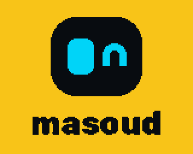
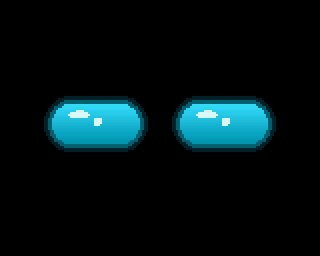
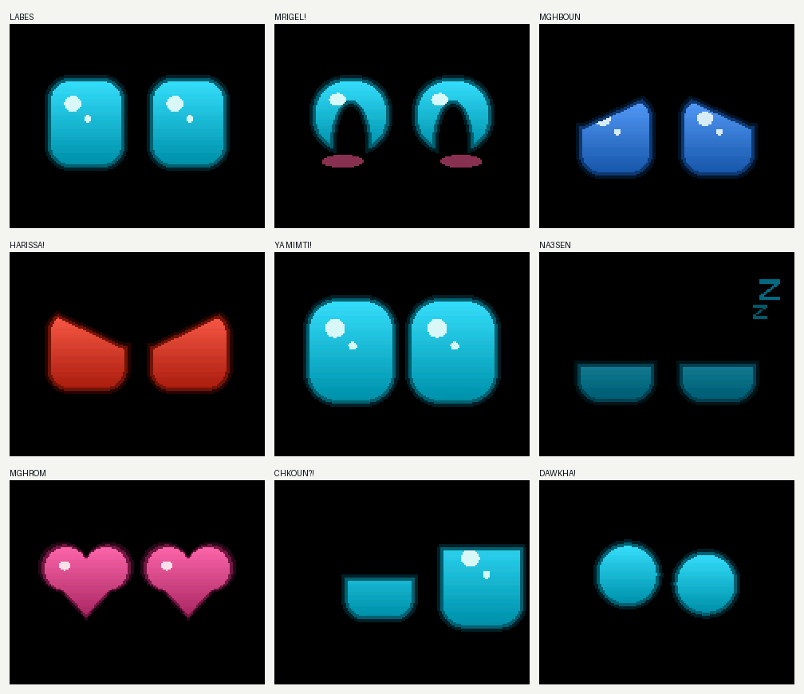

# masoud — the lucky desk buddy


**Masoud** (مسعود, "the lucky one") is a Tunisian desk buddy robot: a face that shows how he
feels, a voice, a shake sensor, and an AI mind you choose on day one, on your own computer,
in the cloud, or none at all. He speaks Derja first. *Kol nhar, mas3oud*: every day, a lucky one.

| Folder | What's in it |
|---|---|
| [`brand/`](brand/) | Logo files as plain SVG paths, and [`launch-book.html`](brand/launch-book.html), the cinematic brand and launch book (open it in a browser): a live 3D Masoud whose eyes follow your pointer, name, logo rules, colors, type, Derja voice, first-run setup, parts, pricing, 90-day plan. |
| [`firmware/masoud_uno/`](firmware/masoud_uno/) | The working prototype: Masoud's face on an Arduino Uno + Waveshare 1.8" ST7735S screen. |
| [`tools/`](tools/) | `emo_preview.cpp` renders the face on a PC with the same code, `make_splash.py` builds the boot wordmark, `make_logos.py` builds the logo SVGs. |
| [`docs/`](docs/) | Images used here. |

## The face today

 



He boots on his logo with a hello chirp, then lives on his own: glowing eyes with sparkles,
blinks, glances, blush when he's happy, and every few seconds a mood with its own sound. Drive him from the Serial Monitor (115200), one key at a time:

| Key | Mood | Key | Mood |
|---|---|---|---|
| `n` | *Labes*, calm | `z` | *Na3sen*, sleepy with Zzz |
| `h` | *Mrigel!*, happy | `l` | *Mghrom*, heart eyes |
| `s` | *Mghboun*, sad | `?` | *Chkoun?!*, suspicious |
| `a` | *Harissa!*, angry | `d` | *Dawkha!*, dizzy: what the shake sensor will trigger |
| `u` | *Ya mimti!*, surprised | `b` `w` | blink, wink |

`4 6 8 2 5` look around, `x` turns autonomous mode on and off. Each mood change is printed in Derja.

### His voice

Masoud uses the same **PAM8403 amp and two small speakers** as the arduino-sound-player
project. The only change is the pin: that project used D9/D10, which drive Masoud's screen,
so the amp input moves to **D3** (Timer2's free PWM output; Timer1 becomes the 8 kHz sample clock).

```
D3  -> PAM8403 left AND right input        optional: D3 --[1k]--+-- amp in, 10 nF to GND
5V  -> PAM8403 VCC
GND -> PAM8403 GND
PAM8403 L/R out -> the two speakers
```

- **Chirps, no PC needed:** every mood has its own robot chirp, synthesized on the Uno
  (rising for *Mrigel!*, a sigh for *Mghboun*, a buzz for *Harissa!*, a wobble for *Dawkha!*),
  plus a hello at boot.
- **Speech from the PC:** `tools/masoud_say.py` turns Arabic text into Microsoft's Tunisian
  voice (`ar-TN-HediNeural`, pitched up a little), shapes it for 28 mm speakers and streams it
  over USB with the sound project's credit flow control. His eyes pulse while he talks.

```sh
pip install edge-tts pyserial          # and ffmpeg on PATH
python tools/masoud_say.py "أسلامة! أنا مسعود" --mood h
python tools/masoud_say.py "أسلامة" --preview hello.wav    # hear it without the robot
```

Listen to [`docs/masoud-voice-sample.wav`](docs/masoud-voice-sample.wav) for what he sounds like
(8 kHz, 8-bit, exactly what the robot plays).

### Build and flash

Wiring (Uno → LCD header): 3.3V→VCC, GND→GND, D13→SCK, D11→MOSI, D10→LCD_CS, D9→DC, D8→RST. Sound: D3 → PAM8403 (above).
The panel is 3.3 V only and RGB order (MADCTL `0x60`). Close the IDE's Serial Monitor before uploading.

```sh
arduino-cli compile --fqbn arduino:avr:uno firmware/masoud_uno
arduino-cli upload  --fqbn arduino:avr:uno -p COM14 firmware/masoud_uno
```

### Preview on a PC

`emo_face.h` and `splash.h` have no Arduino code, so the same files render on a PC. The preview
writes every mood, the boot screen and a 25 fps run, and checks on every frame that the partial
redraw matches a full repaint.

```sh
pip install ziglang
python -m ziglang cc -x c++ -std=c++17 -O2 -fno-exceptions -fno-rtti -fno-threadsafe-statics -Itools/shim tools/emo_preview.cpp -o emo_preview.exe
emo_preview.exe out_dir      # frames 1283, partial-vs-full mismatches 0
```

## Next

The product moves to an ESP32-S3 with a 2" screen, I2S mic and speaker, an accelerometer for
shakes, and a Wi-Fi setup page where the owner picks Local mind (Ollama on a home computer),
Cloud mind, or Pet mode. The launch book has the parts list, prices and the 90-day plan.

The face engine started in the LCD test bench repo, `thefhiter/st7735-lcd-test`.
